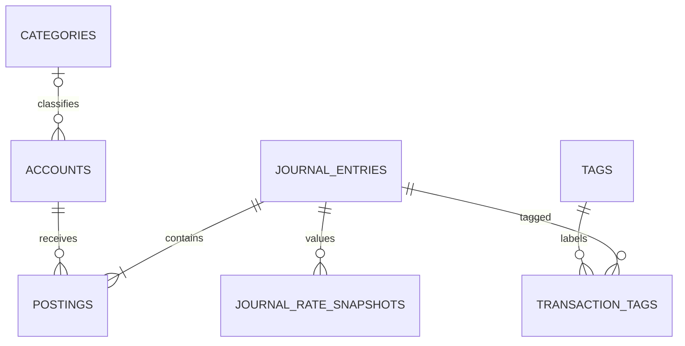

# Veritabanı — PLAN-03 / Accepted

ADR-0011: tek local-first şifreli SQLite, artımlı modül migration, lightweight double-entry, ortak Payment Engine. SQLCipher/Drizzle teknik doğrulama şartlı (ADR-0009). Aşağıdaki finansal çekirdek onaylı tasarım sözleşmesi; henüz DDL veya kod yok. Sonraki modüller kendi aşamasında kesinleşir. JSON blob/EAV finansal ilişkilerin yerine geçmez.

## Çekirdek tablo sözleşmesi

Aksi belirtilmedikçe zorunlu alan; UUID TEXT PK. UTC timestamp ISO-8601 normalize TEXT, local_date YYYY-MM-DD, timezone IANA. Boş opsiyonel değer NULL. Enum/check ve FK gerçek migration'da test edilir.

| Tablo | Alanlar |
|---|---|
| categories | id, name, kind (income/expense), icon, color, archived_at nullable, created_at, updated_at |
| accounts | id, name, kind (asset/liability/income/expense/equity/system), subtype, currency_code, category_id nullable FK, system_key nullable, archived_at nullable, created_at, updated_at |
| journal_entries | id, kind, occurred_at_utc, local_date, timezone, note nullable, source, idempotency_key UNIQUE, related_entry_id nullable FK, relation_kind nullable (reversal/replacement/refund), original_amount_minor nullable, original_currency_code nullable, created_at, updated_at |
| postings | id, journal_entry_id FK, account_id FK, amount_minor INTEGER signed debit + / credit -, created_at |
| tags | id, name, archived_at nullable |
| transaction_tags | journal_entry_id FK, tag_id FK, composite PK |
| templates | id, name, kind, account_id FK, destination_account_id nullable FK, category_id nullable FK, amount_minor nullable, currency_code, note nullable, archived_at nullable |
| exchange_rates | id, base_currency, quote_currency, rate_decimal TEXT, effective_date, source, fetched_at nullable |
| journal_rate_snapshots | journal_entry_id FK, base_currency, quote_currency, rate_decimal TEXT, effective_date, source, captured_at; PK (journal_entry_id,base_currency,quote_currency) |
| settings | singleton id, reporting_currency, locale, theme, privacy; secret yok |

Hesap türü ve currency posting sonrası değişmez. Kullanıcı hesapları cash/bank (asset), credit_card (liability); receivable/payable ADR-0012 ile ödeme modülünde eklenir; credit_card için opsiyonel statement closing/due day. Kategoriye bağlı teknik income/expense hesabı currency başına tek; partial UNIQUE(category_id,currency_code). category kind/account kind uyumu validator; journal'da tekrar category_id yok. Gizli equity opening_balance ve FX clearing hesapları UNIQUE(system_key,currency_code). Teknik hesaplar kullanıcı hesabı/net worth toplamında yer almaz. Açılış bakiyesi equity karşı posting ile; kartın başlangıç borcu gider değildir. Kategori/hesap arşivi geçmişi korur; kullanılan kayıtlar silinmez.

## Finansal yazım ve düzeltme
- Signed minor unit INTEGER; nonzero posting, typeof integer, abs ≤ 9007199254740991. Currency account'tan türetilir. Her journal en az iki posting, currency başına signed toplam 0. Satırlar arası denge application/repository validator ile commit öncesi; tek SQLite CHECK yeterli değildir. Restore aynı kontrolü yapar.
- Journal, postings, snapshot ve tag ilişkileri tek DB transaction; tek yazım kapısı. Idempotency aynı komutun retry'sinde mevcut sonucu döndürür; aynı key/farklı payload hata. Semantic banka dedup PLAN-05.
- Finansal içeriği düzenlemek: orijinalin tam tersini alan reversal + yeni replacement aynı transaction; iptal: yalnız reversal. Her ikisi orijinal aktif kayıtla related_entry_id üzerinden ilişkilendirilir. Reversal için partial UNIQUE(related_entry_id) WHERE relation_kind='reversal'; orijinal/reversal ikinci kez iptal edilmez. Yeni replacement ayrı journal olarak tekrar düzeltilebilir. Reversal ve replacement geçmiş düzeltmesinde ilgili iş tarihiyle raporlanır; created_at gerçek değişiklik anıdır. Tarih değiştirilirse reversal eski, replacement yeni iş tarihini alır. Gerçek iade ise iadenin kendi tarihi ve orijinal ilişkiyle ayrı refund; iade tutarı kalan uygun tutarı aşmaz (cross-currency gerçek tutarlar ayrıca doğrulanır). Reversal ile refund aynı şey değildir.
- Bakiye ve finansal toplamlar bütün geçerli posting'leri (reversal dahil) toplar; iptal edilmiş orijinali ayrıca filtreleyip reversal'ı bırakma. Kullanıcı listesi aktif ekonomik işlemleri gösterir, geçmiş detay erişilebilir. Reversal rate snapshot'ları orijinalden kopyalanır; rapor dönüşümü orijinal ve reversal için aynı uygulanır. Metadata-only note/tag değişikliği yeni posting gerektirmez; updated_at ve basit değişiklik izi korunur; finansal düzeltme immutable. Payment allocation etkileri ADR-0012 uyarınca aynı transaction'da pasiflenir, replacement yeniden eşleştirmesi kontrollü; PAYMENT_RECURRENCE sözleşmesi.
- Hesap toplamları güvenli sayı sınırını doğrular; SQLite SUM güvenli JS sınırı veya 64-bit sınırı aşabilecekse native adapter exact text/BigInt ya da sayfalı posting toplama. Sessiz yuvarlama veya float toplam yok. Cache ancak ölçülen ihtiyaçla.
- FK enforcement her bağlantıda; RESTRICT finansal referanslarda; gerçek veri silen migration/reset yok. Index: journal(local_date,kind), journal(related_entry_id), postings(account_id,journal_entry_id), postings(journal_entry_id), transaction_tags(tag_id,journal_entry_id), rates(base_currency,quote_currency,effective_date,source); query plan ile doğrula.
- Migration versiyonlu ve artımlı; migration transaction (uygun olduğunda), şifreli DB backup/restore, foreign_key_check ve integrity_check. Migration başarısızlığında veri kaybı yok, hata ve kurtarma yolu. Cihaz/SQLCipher/Drizzle uyumu DEV-00.

## Sonraki modüller
| Modül | Model |
|---|---|
| Ortak ödeme (ADR-0012 Accepted) | payment_schedules, payment_occurrences, payment_allocations; [PAYMENT_RECURRENCE](PAYMENT_RECURRENCE.md) |
| Taksit/borç | Ayrı tablo yalnız ortak schedule alanları yetmezse; asset/liability bağlantısı |
| Bütçe/birikim | budgets, savings_goals; [FINANCIAL_INTELLIGENCE](FINANCIAL_INTELLIGENCE.md) ADR-0013 Accepted; budget_periods yok başlangıçta. accounts.include_in_spendable ve payment_schedules.required artımlı migration ile. |
| Capture | capture_candidates, automation_rules, merchant_mappings; semantic dedup PLAN-05 |
| Widget / analiz / takvim | Read model + minimum platform snapshot; ayrı finansal veri kaynağı yok |
| Backup / sync | PLAN-07; sync_outbox/change_log yalnız protokol gerektirirse |

PLAN-03 tasarım onaylandı; DDL, exact adapter testi ve sonraki modül kolonları yapılmadı. [Para ve kur](MONEY_CURRENCY.md) tamamlayıcı sözleşmedir.
