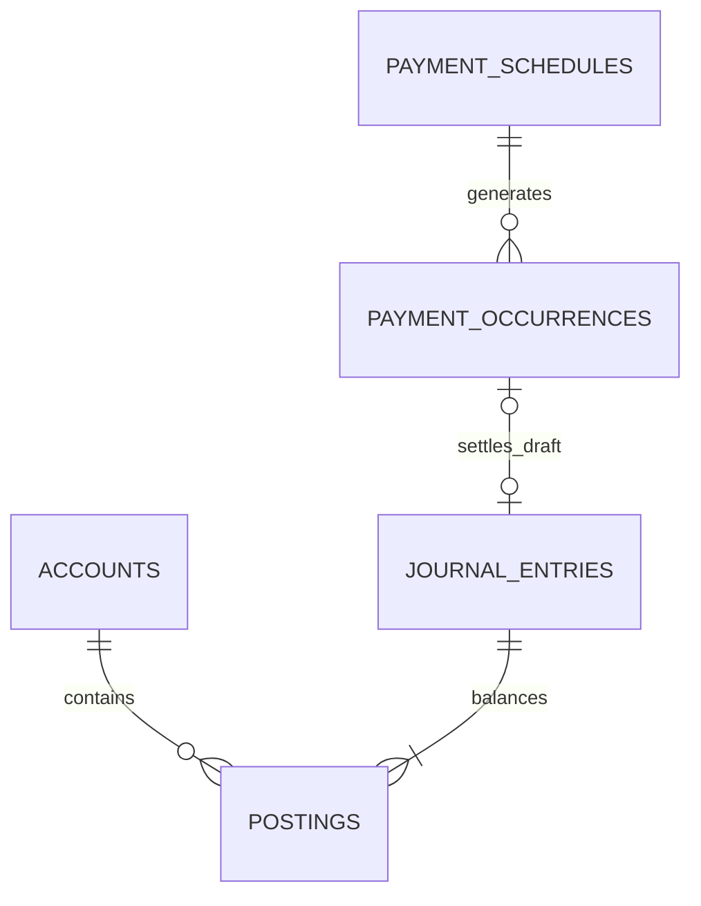

# Veritabanı taslağı — Proposed

Tek şifreli SQLite, Drizzle migration ve DAO/repository (koşullu stack). ADR-0006 ile lightweight double-entry çekirdeği (accounts, journal_entries, postings) Accepted; diğer aday tablolar, kesin kolonlar ve ilişkiler Proposed. Üç tablo tüm ürün değil, yalnız kayıt çekirdeğidir. Gerçek şema henüz tasarlanmadı. Gereksiz muhasebe tabloları/event store yok; gereken planlama, capture ve diğer kapsam tabloları ayrı tasarlanacak.

| Alan | Aday tablolar |
|---|---|
| Accounting | accounts, journal_entries, postings, exchange_rates |
| Transactions | categories, tags, transaction_tags, templates |
| Planning | subscriptions, payment_schedules, payment_occurrences, installments, debts |
| Intelligence | budgets, budget_periods, savings_goals |
| Capture | capture_candidates, automation_rules, merchant_mappings, deduplication_keys |
| Infra | settings, change_log, sync_outbox, audit_log |

Partial payment gibi senaryolar çözülmedi; nihai kardinalite değil. UUID, schema version, revision, tombstone, FK, unique idempotency, atomik transaction önerilir. Index query planına göre; ilk sürüm sync outbox gereksinimi ayrıca değerlendirilecek. Şifre anahtarı/background/biometric birlikte test. Gerçek veri migration'da sıfırlanmaz. ERD, kolon tipleri, constraint, DDL sonraki aşama.
