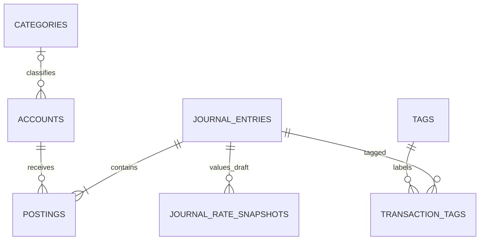

# Veritabanı taslağı — PLAN-03 / Proposed

ADR-0006 Lightweight double-entry ve ADR-0010 Money & Currency bağlayıcı. Tek local-first şifreli SQLite, Drizzle migration (koşullu teknoloji yığını). Aşağıdaki şema tasarımdır; DDL, scaffold veya kod yok. Kısıtlı bütçeyle modül bazında artımlı migration; bütün tabloları başlangıçta yaratma. Her özellik için ayrı tablo şart değil, ancak finansal ilişkiler JSON blob/EAV içine gömülmez.

## İlk dikey dilim: finansal çekirdek

Kolonlar öneridir. PK/FK ilişkileri gerçek migration aşamasında doğrulanır.

| Tablo | Önerilen kolonlar |
|---|---|
| accounts | id TEXT PK, name, kind (asset/liability/income/expense/equity/system), subtype, currency_code, system_key nullable, archived_at, created_at, updated_at |
| journal_entries | id TEXT PK, kind, occurred_at_utc, local_date, timezone, note nullable, source, idempotency_key UNIQUE, related_entry_id nullable FK, revision, voided_at nullable, created_at, updated_at |
| postings | id TEXT PK, journal_entry_id FK, account_id FK, amount_minor INTEGER signed (debit +, credit -), created_at; currency account'tan türetilir |
| categories | id TEXT PK, name, kind income/expense, icon, color, archived_at; sistem kategori hesaplarıyla eşleme (hesap başına currency; mapping kararı aşağıda) |
| tags | id TEXT PK, name, archived_at |
| transaction_tags | journal_entry_id FK, tag_id FK, composite PK |
| templates | id TEXT PK, name, kind, account_id FK, destination_account_id nullable, category_id nullable, amount_minor nullable, currency_code, note, archived_at |
| exchange_rates | id TEXT PK, base_currency, quote_currency, rate_decimal TEXT, effective_date, source, fetched_at nullable; manuel/otomatik ve tarihsel kayıt ayrımı |
| settings | tek yerel profil; reporting_currency, locale, theme, privacy; secret/anahtar yok |

Kategori ↔ teknik gelir/gider hesabı eşlemesi için öneri: accounts.category_id nullable FK ve (category_id, currency_code) unique partial index. Gelir/gider posting'inin kategorisi bu ilişkiden türetilir; category_id journal'da tekrar tutulmaz. Bir kategori farklı döviz hesaplarıyla kullanılabilir. Sistem hesapları UI dışında ve deterministik unique (system_key,currency_code). Hesap para birimi ilk posting'den sonra değişmez.

Kur tarihsel kayıtları yeniden yazılmaz. Önerilen journal_rate_snapshots (journal_entry_id, base_currency, quote_currency, rate_decimal, effective_date, source; birleşik unique) yalnız gerekli işlem çiftleri için; exchange_rates güncel cache'tir. Alternatif olarak aynı tablonun immutable kayıtlarına FK kullanılabilir; kesin karar onaydan sonra. [Money & Currency](MONEY_CURRENCY.md) FX clearing ve tarihsel değerleme önerisini içerir.

## Sonraki modüller — aday model
| Modül | Aday tablolar / yaklaşım |
|---|---|
| Ödeme planı | payment_schedules (subscription/bill/rent/recurring/installment/debt türleri, recurrence, hesap, para, durum); payment_occurrences (vade, tutar, durum); payment_allocations (occurrence ↔ journal, kısmi ödeme destek adayı) |
| Taksit/borç | installments, debts yalnız ortak schedule alanları yetersizse; borç/alacak liability/asset hesaplarına bağlanır; taksit planının gerçekleşme ve bütçe semantiği PLAN-04 |
| Bütçe | budgets (category nullable, period, amount, currency); budget_periods yalnız geçmiş dönem hedefi gerekirse |
| Birikim | savings_goals; hedef ilerlemesi bağlantılı hesap/ayırma semantiğinden türetilir (PLAN-04) |
| Capture | capture_candidates, automation_rules, merchant_mappings; dedup için canonical fingerprint/index, ayrı tablo ancak gerekirse (PLAN-05) |
| Widget / analiz / takvim | SQLite read model + minimum platform snapshot; ayrı finansal kaynak veya önceden hesaplanmış tablo yok |
| Yedek / sync | schemaVersion, revision, tombstone; sync_outbox/change_log yalnız sync sözleşmesi gerektirirse (PLAN-07) |

## Veri bütünlüğü — Proposed
- UUID TEXT PK; zaman UTC ve yerel iş tarihi ayrı, planlar yerel takvim. FK enforcement her bağlantıda doğrulanır; kullanılan hesap/kategori arşivlenir, cascade ile finansal geçmiş silinmez.
- amount_minor INTEGER, typeof ve güvenli JS sınırı CHECK; sıfır posting yasak; currency account'tan türetilir. SQLite toplamlarının da güvenli sınırı aşması kontrol edilir; gerekiyorsa kontrollü BigInt toplama.
- Journal + en az iki posting + varsa rate snapshot + kaynak dedup tek DB transaction. Aggregate balance her currency bazında validator ile commit öncesi kontrol edilir; sıradan CHECK satırlar arası dengeyi tek başına sağlayamaz. Yazım kapısı application/repository, restore/import aynı validasyonu kullanır.
- Void ve edit için ilişkilendirilmiş reversal/düzeltme, tarihsel kayıtları kaybetmeme; kesin düzenleme/iptal semantiği ayrı onay. Aktif/voided toplamların double count yapmaması şart. Idempotency key aynı komut retry'sini engeller; farklı banka kanallarının semantic dedup'ı PLAN-05.
- Önerilen index: journal(local_date,kind), postings(account_id,journal_entry_id), postings(journal_entry_id), transaction_tags(tag_id,journal_entry_id), rates(base_currency,quote_currency,effective_date,source); sonraki modül index'i gerçek sorguya göre.
- Şifreli migration ve backup bütünlük kontrolü; gerçek veri reset yok. DB versiyonu, migration sırası, foreign_key_check ve kritik fixture'lar DEV-00/uygulama fazında doğrulanır.

## Onay sınırı
PLAN-03 aktif; şema henüz Proposed. İlk çekirdek ve artımlı migration stratejisi gözden geçirilecek. FX clearing, rounding, JSON sözleşmesi, edit/reversal ve planlama semantiği taslaktır. PLAN-04/05/07 alanları kendi teknik aşamasında kesinleşir. Kodlama onayı yok.
