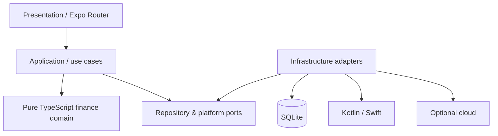

# Teknik mimari

Accepted: React Native + Expo + TypeScript, Android/iOS, local-first, Pure Apple, hibrit capture. Proposed: feature-first modular monolith, ports & adapters, pragmatik Clean Architecture, üç ortak paket. Flutter superseded.

Domain saf iş kuralları; application orkestrasyon; presentation ekran/hook/UI state; infrastructure persistence, native, network. Tek uygulama, tek finansal veri kaynağı. Microservice, gereksiz abstraction veya her feature için ayrı workspace yok. Mobile composition root DI ve adapter wiring. Native olay yakalar, ortak motor kayıt oluşturur; widget snapshot okur. Bulut kapalıyken temel deneyim devam eder. İlk spike: native lifecycle, SQLCipher, widget target ve background erişimi. Henüz test edilmedi.
