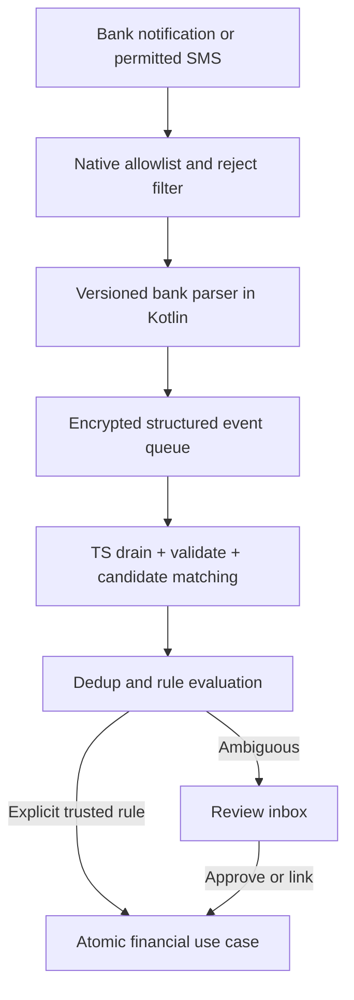

# Smart Capture — PLAN-05 / Accepted (ADR-0014)

ADR-0005 Accepted: Android banka bildirim/SMS, önce inceleme sonra açık güvenilir kuralla otomatik; iOS manuel/şablon. ADR-0014 ile teknik tasarım Accepted; öncelikli entegrasyon hedefleri Akbank ve Ziraat Bankası. Banka desteği ve fixture doğrulanmadı. Ücretli API, LLM, OCR, banka API, accessibility scraping, zorunlu server yok.

## 1. Kaynak ve dağıtım kapısı
Android bankanın kendi uygulama push bildirimi: NotificationListenerService, ayrı kullanıcı onayı, yalnız kullanıcının seçtiği doğrulanmış banka package allowlist. Notification access OS düzeyinde geniş erişim sağlar; uygulama diğer paketlerin içeriğini işlemez/saklamaz. SMS: yalnız yeni gelen SMS_RECEIVED ve RECEIVE_SMS, ayrı opt-in, doğrulanmış banka sender allowlist. READ_SMS/history scan yok, SMS default app olma gereği tasarlanmaz. SMS sender spoof edilebilir; içerik banka mutabakatı değildir. Google Play SMS-based money management istisnası mevcut fakat declaration/review/approval ve kullanım kurallarına tabi; Android RECEIVE_SMS hard-restricted/installer allowlist gerektirir. Personal APK da garanti değil. Notification-only build manifest SMS izin/receiver içermesin; SMS-enabled variant yalnız izin ve dağıtım uygunsa. SMS uygulamasının bildirimini okuyarak SMS policy aşma yok. iOS üçüncü taraf banka push/SMS listener yok. Her platform manuel/template fallback.

Kaynaklar (2026-11-28 kontrolü): https://developer.android.com/reference/android/service/notification/NotificationListenerService ; https://developer.android.com/reference/android/Manifest.permission#RECEIVE_SMS ; https://developer.android.com/reference/android/provider/Telephony.Sms.Intents ; https://support.google.com/googleplay/android-developer/answer/10208820 ; https://support.google.com/googleplay/android-developer/answer/9214102 . Dağıtım anında güncel policy ve cihaz doğrulanacak.

## 2. Minimum mimari

Ham metin yalnız native memory; paket/sender önce doğrulanır, OTP/PIN/password/full PAN/login/reklam/başarısız/pending/declined olaylar persist edilmeden atılır. Pozitif finansal şablon match şartı. Bilinmeyen içerik raw olarak saklanmaz; yalnız güvenli non-content diagnostic count, manuel giriş fallback. Tam PAN, IBAN, telefon, müşteri/kimlik no, OTP, raw body/title, notification extras, kişisel mesaj, available balance/limit saklanmaz. Maskeli hesap son 4 hane isteğe bağlı ve açık onay; merchant whitelist/sanitizer + bounded length; belirsiz alan NULL/review. Native parser tek implementasyon, Kotlin regex + küçük bank-specific registry, sentetik fixture. Ortak finansal semantik ve dedup TS; native ledger'a yazmaz. Karmaşık parser DSL, çift dil parser, remote dynamic regex update yok. Parser version kayıtlı, app release ile güncellenir.

## 3. Olay ve queue
CaptureEnvelope v1: eventId UUID, source(notification/sms), bankId, eventKind(expense/income/refund/transfer/card_payment/unknown), amountMinor canonical integer string nullable, currency nullable, originalAmountMinor/originalCurrency nullable, maskedAccountHint nullable, merchantNormalized nullable, bankRefHmac nullable, sourceEventHmac, occurredAt nullable, receivedAt UTC, parserId/version, quality flags; hiçbir raw içerik. Timestamp yalnız bildirimin alındığı zamansa occurredAt tahmini olarak işaretlenir. Sender/package doğrulama sonucu, exact/uncertain parse flags; schema Zod/native validate.
- Native persistent bounded encrypted queue, Android app-private storage + Keystore-backed AES-GCM, unique nonce; ayrı küçük dosya/queue store, finansal SQLite ikinci kopyası değil. Key ve queue backup dışı. Before-first-unlock/key unavailable ise OS kısıtı; hassas düz metin fallback yok. 7 günlük TTL, max 500 structured events; full/expiry kullanıcıya güvenli count uyarısı, manuel fallback. Native raw event kesinlikle disk/log/network yok. Queue write başarılı olmadan capture success denmez.
- Önce düşük maliyetli akış: service/receiver olayı yakalar ve kuyrukta saklar; app foreground/start/resume/explicit refresh drain, JS açıkken native event trigger. Ack yalnız SQLite candidate commit sonrası; retry/restart aynı eventId/source key idempotent. Headless JS/WorkManager spike yalnız app kapalıyken kayıt gecikmesi önemliyse ve DB key güvenliği, battery/OS koşulları doğrulanırsa; zorunlu servis/polling/wakelock yok. Kullanıcı force-stop, reboot, izin geri çekme, OEM battery ve OS redaction nedeniyle olay kaçabilir, 7/24 garanti yok. Uygulama kapalıyken native queue'ya düşmek ledger'a otomatik yazılmış demek değil.
- Global pause ve kaynak/banka toggle native katmanda kontrol edilir; izin iptalinde yeni capture durur, pending'ler kullanıcıya gösterilir/purge seçeneği; otomasyon kapalı. Global stop yeni commit öncesi tekrar kontrol; kullanıcı bekleyen adayları manuel onaylayabilir. Queue retention ve key lifecycle PLAN-07 security ile birlikte kesinleşir.

## 4. Üç tabloluk model (Accepted)
capture_candidates: id, bank_id, event_kind, amount_minor nullable, currency_code nullable, original_amount_minor/original_currency nullable, merchant_normalized nullable, account_hint_masked nullable, account_id nullable FK, category_id nullable FK, occurred_at nullable, received_at, source_event_key UNIQUE, bank_ref_hmac nullable, source, parser_id/version, quality_flags (bounded enum list), status (pending/approved/auto_committed/rejected/linked/undone), journal_entry_id nullable FK, rule_id nullable FK, expires_at nullable, created_at, updated_at. Finansal tablo içinde asla raw body. Pending retention 30 gün; rejected/linked fingerprint metadata TTL 30 gün; journal geçmişi korunur, kullanıcı adayını silebilir. Dedup linki için canonical event key ve bank-ref HMAC unique yalnız doğrulanmış stable reference scope (bank/account/kind/ref); separate dedup table ancak gerçek ihtiyaç olursa. HMAC device secret Keystore; restore sonrası key rotation durumunda otomasyon review-first, hash global banka referansı gibi davranmaz.
merchant_mappings: id, bank_id, account_id, normalized_merchant, category_id, confirmed_count, updated_at; kullanıcı onayından öğrenir, kural otomatik etkinleşmez. Basit exact normalized matching, fuzzy/ML yok.
automation_rules: id, enabled, bank_id, source_scope, account_id, event_kind, currency_code, merchant_match, min_minor nullable, max_minor required, category_id, parser_id/version (uyumsuz değişimde disabled), created_at, updated_at. Explicit enable/disable/edit; max amount kullanıcı seçer; genel limit yoksa auto yok. Birden fazla çakışan rule → review. Account/category archived → review. Başlangıçta bütün olaylar pending. Merchant mapping yalnız öneri. Unique confirmed account mapping (bank+masked hint) çakışırsa review. Hesap eşleştirmesi UI'da doğrulanır; ek tablo ancak gerekli.

## 5. Dedup ve otomasyon
1) Aynı source event/retry exact key: mevcut candidate döndür; notification update aynı key farklı içerikse review, sessiz overwrite değil. Notification key tek başına transaction ID değil, reuse/update test. Strong bank ref HMAC + account/currency/kind/amount tutarlılığı ve scope varsa link; conflicting strong ref → review.
2) SMS/push/manual karşılaştırması: aynı hesap, tür, currency, amount, normalize merchant ve yakın zaman (±5 dakika, inferred timestamp ise daha geniş arama fakat yalnız review); mevcut journal/candidate eşleşme adayları. Weak fingerprint kesin duplicate değildir; iki gerçek aynı tutarlı alışveriş silinmez. Belirsiz eşleşmede auto yok, 'mevcut işleme bağla' / 'ayrı işlem' / 'reddet' kullanıcı kararı. Manuel kayıt sonrası açık pending aday varsa uyarı; kullanıcı onayı olmadan journal birleştirme yok.
3) Auto yalnız açık rule + supported exact parser, kesin settled expense, tek confirmed account/category, güvenilir tutar/currency, explicit max limit, unique rule, açık timestamp veya rule tarafından kabul edilmiş received timestamp (varsayılan review), dedup çatışması yok, kullanıcı izin/auto durumu etkin. İlk sürüm otomatik gider only; refund/income/transfer/card_payment/FX ambiguous/unknown her zaman review, manuel onayla uygun financial use case. SMS spoof riskinden dolayı ilk sürüm SMS adayları review-only; SMS+push exact strong link öneri. SMS auto gelecekte ayrı güvenlik/onay. Trusted bank push bile mutabakat garantisi değildir.
4) Aday approval/auto commit tek SQLite transaction: idempotency key capture:eventId + journal + postings + candidate status + explicit payment allocation yalnız unique verified match. Abonelik eşleşmesi belirsizse kullanıcı inceleme, asla iki journal değil. Banka ödeme bildirimi kart borcu olabilir; gider olarak varsayma. Gerçek iade orijinal transaction ilişkisi, belirsizse review. Undo append reversal (ADR-0011) ve allocation pasifleme, candidate undone; kuralı durdurma seçeneği. Undo sonrası aynı event tekrar auto olmaz. Rejected olay yeniden işlem yaratmaz; kullanıcı explicit restore candidate mümkünse review.
5) Finansal çekirdek validation/transaction başarısız → pending/error, auto başarı gösterme. Inbox güvenli açıklama, edit category/account/amount/date, onay, mevcut işleme bağla, reddet, undo, global pause. Kullanıcıya kaynak + parser durumu + son başarılı capture + bekleyen adet; bank destek listesi yalnız fixture ve cihaz doğrulaması sonrası.

## 6. Banka stratejisi ve test
İlk iki entegrasyon hedefi Akbank ve Ziraat Bankası (ürün sahibi seçimi). Önce ikisinin push fixture ve cihaz doğrulaması; diğer bankalar sonraki genişletme adayları. İsimler destek taahhüdü değil. Package/sender değerleri resmi uygulama/cihaz ve maskeli fixture ile doğrulanır, tahmin edilmez. Test fixture yalnız sentetik veya kullanıcı tarafından kişisel alanları silinmiş örnek; gerçek OTP/kimlik/tam kart/hesap no paylaşma, Git'e koyma. Test: positive/negative parser, Türkçe format 1.234,56, decimal currency, refund/declined/pending/OTP, unknown template, duplicate key/content conflict, identical repeated purchases, SMS/push/manual, account ambiguous, rule disabled/over-limit/version change, permission revoke, queue crash/retry/TTL, force-stop/reboot/OEM, locked DB/key unavailable, reversal/settlement, no raw logs. DEV-00 native spike, PLAN-07 security, policy gate. Henüz banka, cihaz, izin veya background testi yapılmadı.

## 7. Kesin teknik seçimler — ADR-0014
- Akbank ve Ziraat Bankası ilk hedef, kişisel hesap bilgisi veya gerçek mesaj örneği repo'ya yazılmaz. Package adı ve sender yalnız resmi kaynak + cihaz doğrulamasından sonra allowlist; bilinmeyen banka capture kapalı. Notification-only ilk build; SMS variant ayrı policy/installer gate ve review-only. iOS manual/template.
- Önce foreground drain + native durable encrypted structured queue. WorkManager/Headless JS zorunlu değil; ancak gerçek ihtiyaç, izin ve key/lifecycle spike başarılıysa eklenir. Uygulama kapalıyken ledger güncellenmesi garanti edilmez.
- Native queue TTL 7 gün, 500 event üst sınırı. Taşmada yeni olayı düşür ve non-content overflow counter göster; eski işlenmemiş olayı sessizce ezme. Expiry ve kullanıcı purge ile sil, plaintext fallback yok. Queue encryption key ve HMAC key ayrıdır; queue/keys backup dışında. PLAN-07 key lifecycle son kontrolü.
- Capture source key, bank reference ve weak fingerprint ayrımı: idempotency yalnız doğrulanmış aynı source event/version veya aynı queue event. Aynı notification key farklı içerik/yeniden kullanım ise ayrı candidate + conflict flag. Stable bank ref güçlü eşleşme sadece scope ve tutar/tür/hesap doğrulaması ile. Weak match ±5 dk, inferred timestamp ±24 saat yalnız inceleme; yakın tutar tek başına merge değil. İşlenmiş adayın finansal journal linki ve minimum pseudonymous idempotency bilgisi replay önleme için korunur; 30 gün sonra merchant/hint gibi gereksiz aday alanları temizlenir. Rejected fingerprint TTL 30 gün, expired event auto-replay edilmez. Kullanıcı purge ile capture geçmişi temizlenebilir; mevcut finansal journal/reversal korunur, auto review-first yapılır.
- Confirmed hesap eşleştirmesi: accounts üzerinde nullable capture_bank_id ve capture_hint_hmac (bank + kart/hesap tipi + maskeli hint); kullanıcı onayıyla, çakışma review. HMAC ham hint yerine; son dört hane yalnız açık izinle candidate UI'da. Key restore/rotation review-first. merchant_mappings unique(bank_id,account_id,normalized_merchant); exact normalization, no fuzzy. automation_rules exact merchant, source push, currency, account/category, max limit ve parser version; varsayılan kapalı; tüm rule koşulları sağlanmazsa pending.
- Pending ve approved/linked/auto_committed/undone/rejected yaşam döngüsü; invalid parse non-content count; candidate write+queue ack, journal+status+allocation atomic. Rejected/undo tekrar auto olmaz; kullanıcı açık yeniden inceleme. Gate kapalıysa candidate manuel işlenebilir. Background auto yalnız destek kanıtı sonrası.
- Index candidate(source_event_key), candidate(bank_id,bank_ref_hmac), candidate(status,received_at), candidate(account_id,occurred_at,amount_minor,currency_code); strong ref conflict tekil index ile sessizce kaybolmaz. Otomasyon rule ve mapping sorguları index; safe integer, FK RESTRICT, bounded retention. Üç tablo + account alanı; ek dedup altyapısı yok.
- Banka formatı bilinmeden örnek parser production diye işaretlenmez. DEV-00: native listener, app-private queue, signing, izin ve force-stop/reboot; bank-specific fixture ve gerçek cihaz doğrulaması geliştirme fazında. SMS izin gate geçmezse destek blocked, manuel/push çalışır. Kodlama izni yok.
