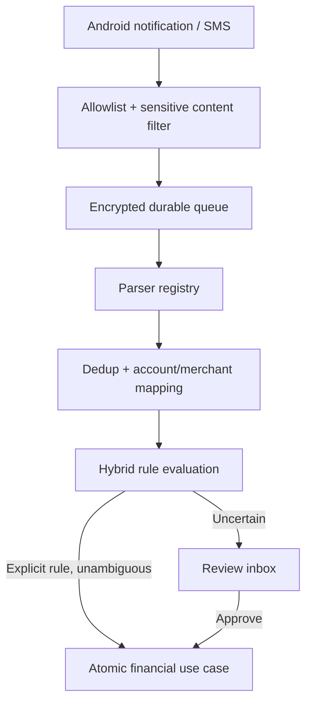

# Smart Capture — davranış Accepted, teknik Proposed

Android banka bildirim/SMS onaylı. iOS eşdeğer erişim yok. Manuel/şablon ortak. Play SMS izinleri değerlendirme/istisnaya tabi; kişisel APK ve mağaza farkı test edilir, onay garanti değil.

Önce tüm adaylar onay; merchant/kategori/hesap eşleştirmesi öğrenilir; kullanıcı önerilen kuralı etkinleştirir; açık güvenilir kural otomatik kayıt. Banka, kart, merchant, kur, işlem türü, tutar sınırı; belirsiz/çakışan inceleme. Düzenleme, ret, geri alma, kural kapatma. Global durdurma ve yüksek tutar onayı önerilir. Ücretli LLM gerekmez; yerel regex ve kural parser.

OTP, ilgisiz/başarısız işlem, kişisel mesaj, tam kart numarası ve şifre saklanmaz. Ham SMS/bildirim bulut/Git/log yok. Minimum finansal alan, retention, şifreli queue ayrı tasarım. UI kapalıyken WorkManager/Headless JS spike; OS engellerse uygun sonraki zaman. Manuel + SMS + notification dedup, gerçek referans varsa kullan; sadece tutar/saat kesin duplicate değil. İade, gelir/transfer, kart borcu ve abonelik eşleştirme ayrı senaryo.

Banka adayları: Ziraat, İş Bankası, Garanti BBVA, Yapı Kredi, Akbank, Enpara, VakıfBank, Halkbank, QNB, DenizBank, TEB, Papara. Destek iddiası yok; öncelik ürün sahibi bankaları ve sentetik/maskeli fixture. İzin iptalinde manuel devam. Desteklenen bankalar, güven skorları, dedup penceresi, otomasyon limitleri, yaşam döngüsü ve queue sözleşmesi pending.
