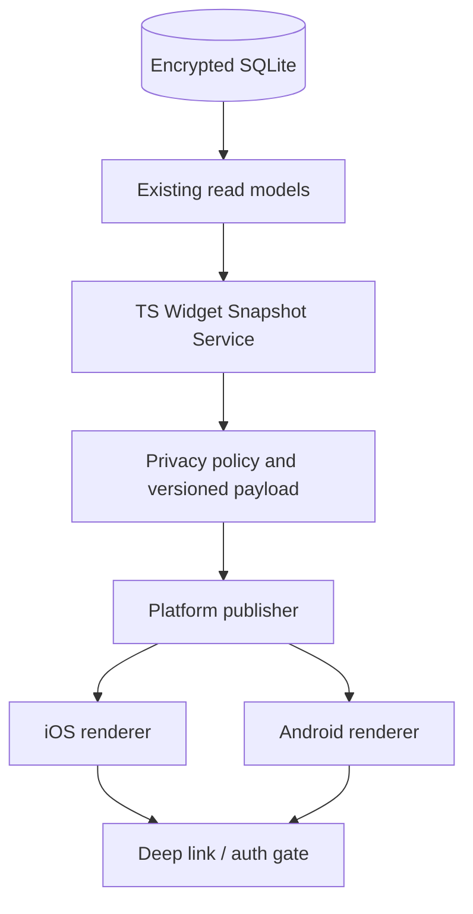

# Native Widget Architecture — PLAN-06 / Accepted (ADR-0015)

Altı home-screen widget kapsamı Accepted. Teknik tasarım Accepted; renderer seçimi ADR-0009 doğrulama kapısına bağlı. Hedef: premium, hızlı ve maliyetsiz yerel widget; yeni backend, ücretli servis, ayrı finans motoru, doğrudan SQLite veya DB key erişimi yok.

## 1. Platform stratejisi
Önce DEV-00 içinde seçili Expo SDK ile expo-widgets proof of concept (daily spend + quick add deep link, iki platform, privacy purge, build/prebuild). Güncel doküman sürümleri Android desteği açısından tutarsız: arama indeksinde Android createWidget mevcutken açılan sürüm iOS-only gösteriyor. SDK/gerçek API ve cihaz doğrulanmadan Android desteği iddia edilmez. Gerekli tüm özellikleri karşılayan Expo Widgets mümkünse kullan; karşılamıyorsa yalnız ilgili platformda Jetpack Glance (Android Kotlin) veya SwiftUI/WidgetKit (iOS). İki paralel renderer aynı platformda yok; tek adapter seçilir. Seçim ADR-0009 gate, başarısızlıkta bulgu/alternatif kaydı ve onay. Expo Go değil development build. Native target config plugin/prebuild koruması, iOS App Group entitlement/signing, Android receiver/launcher resizing DEV-00.

Kaynaklar: https://docs.expo.dev/versions/latest/sdk/widgets/ ; https://developer.apple.com/documentation/widgetkit/keeping-a-widget-up-to-date/ ; https://developer.android.com/develop/ui/compose/glance/glance-app-widget ; https://developer.android.com/develop/ui/compose/glance/create-app-widget . Doküman kontrolü 2026-11-28; cihaz doğrulaması yok.

## 2. Ortak veri akışı

apps/mobile application service, pure core read-model hesapları ADR-0013, platform publisher port packages/sumlune-platform. Renderer yalnız snapshot ve UI, finansal toplama/FX/işlem yazımı yok. Snapshot derived cache, finansal kaynak değil. Shared App Group on iOS, app-private storage/no backup Android; Expo snapshot store varsa aynı privacy şartları. Atomic replace/versioned publication, stale revision drop, bounded payload, no raw capture/DB/keys. Shared storage OS erişim modeli ve privacy purge doğrulanır.

## 3. Altı widget
| Tür | Small/compact | Medium/expanded | Açılış hedefi |
|---|---|---|---|
| Günlük harcama | Bugün net gider, adet | Günlük net gider, önceki gün farkı (varsa) | İşlemler bugün filtresi |
| Yaklaşan ödemeler | En yakın vade, kalan | İlk 3 açık vade, overdue ilk | Planlama / ödeme detayı |
| Abonelik | Aylık eşdeğer, aktif adet | Sıradaki yenileme + aylık eşdeğer | Abonelikler |
| Aylık bütçe | Overall veya seçili kategori kullanım/kalan | Limit, net gider, kalan | Bütçe detayı |
| Hızlı harcama | + Ekle | Tek ekleme ve varsa seçili şablon shortcut | Yeni gider / template preview |
| Hesap bakiyesi | Seçili hesap veya toplam | Bakiye + currency ve kapsam | Hesap detayı/özet |

Native responsive size: iOS small/medium başlangıç; Android launcher ölçülerine göre compact/expanded. Large/lock screen/live activities/watch/interactive write başlangıç kapsamı değil. App içinde widget ayarları ile tür başına varsayılan scope, tek konfigürasyon (aynı türün birden fazla instance'ı başlangıçta aynı seçim); OS per-instance configuration ancak destek doğrulanırsa sonraki iyileştirme. Default hızlı ekle deep link, doğrudan para kaydetme yok. UI Pure Apple tokenlarının native karşılıkları, light/dark/tinted, system font, tabular numbers, erişilebilirlik.

## 4. Snapshot v1 sözleşmesi (Accepted)
Tek atomic envelope, tür başına minimal discriminated payload; publisher renderer'a yalnız ilgili alanı verir. schemaVersion=1, generation/revision monotonic, generatedAt UTC, localDate, timezone, locale, currencyCode, validUntil UTC, privacy (masked/visible), dataState (ready/empty/incomplete/stale/locked), widgetKind, minimal data. Financial amounts canonical minor integer string + displayText (TS formatter), ratios bounded display; renderer hesaplama yapmaz. Stale/unknown schema/corrupt/missing -> güvenli placeholder + aç. Per-kind:
- daily: localDate, netExpenseDisplay, count; negative refund state; not current after local midnight.
- upcoming: max 3 items, opaque occurrence id, sanitized label if opted-in, dueDate, remainingDisplay, status; overdue derived by app.
- subscription: normalizedMonthlyDisplay, activeCount, nextRenewalDate; incomplete flag.
- budget: opaque budget scope, limit/used/remainingDisplay, clamped progress, overspent flag; month validity.
- quickAdd: action route enum, optional opaque template id, no amount/category details by default.
- balance: scope, balanceDisplay, currency, optional safe generic label; selected liability labeled debt not cash, aggregate net worth or operating cash scope explicit (default operating cash). Missing FX incomplete.
Only opaque UUID routes (not account number), no personal names/merchant/raw transaction detail/notes, account identifiers, IBAN/PAN or bank balance metadata beyond explicitly opted-in value. Masked payload excludes amounts, progress, counts or labels that disclose financial state; only generic text/icon and safe open route. Not hidden via CSS. No widget network requests. Unknown data cannot display zero as true value.

## 5. Yenileme ve veri tutarlılığı
After successful ledger/payment/budget/capture commit, settings/privacy/locale/FX change, restore and app foreground -> rebuild affected snapshot. Coalesce bursts (250 ms debounce, privacy immediate), write then request OS reload. Snapshot generation version compare prevents older visible payload overwrite after mask. Dirty flag/retry on publication failure; ledger commit not rolled back because widget failed. At midnight/month rollover, if no freshly computed data, display last updated/stale or safe placeholder; don't show yesterday as today. Timeline entries for predictable expiry only, no fake future balances. Native calendar labels may update presentation without financial recalculation. No polling/server/exact alarm for widget; WidgetKit timeline budget and Android launcher scheduling mean immediate reload not guaranteed. Optional low-frequency existing platform update hook after spike, no background DB key solely for widget. Capture queued while app closed not yet journal; widget doesn't include candidates.

## 6. Gizlilik ve güvenli etkileşim
Default masked; visible values explicit widget-kind-specific opt-in, warn home screen/launcher exposure. Global hide sensitive amounts and restore/sign-out/lock-policy changes override opt-in, publish masked payload, clear prior stored visible snapshots and request reload immediately. No guarantee OS/launcher cached render disappears instantly; tell user. ADR-0016: biometric app lock enabled ise tüm widget'lar maskeli, kullanıcı görünür tutar izni veremez. Lock kaldırılırsa yeniden ayrı opt-in; never unlock via widget. iOS privacySensitive/redaction and Android safe fallback where supported; lock screen widgets not in initial scope. Widget extension/shared storage never receives master key. Snapshot excludes backups, safe deletion/reinstall; invalid version/malformed data -> masked. In-flight publisher checks privacy generation before write and reload. Deep link allowlist route + opaque ID validation, no amounts/secrets in URI, stale/invalid IDs fallback, biometric/auth gate before sensitive screen. No direct financial mutations from widget. Quick add opens form and explicit save; template preview user confirms. No OS widget interaction bypass.

## 7. Test ve bütçe
Priority: quick-add + daily first, then upcoming + balance, then budget + subscription (all six retained). Shared publisher tests use synthetic fixture. Verify both sizes, empty/corrupt/stale/unknown schema, midnight/month rollover, missing FX, locale/theme, masked payload no sensitive data, visible→mask race + reload, app lock/auth, deep link injection/invalid ID, uninstall/restore, capture queue not ledger, atomic write crash/retry, prebuild/signing, launcher actual refresh. Verify at least Android real device + iOS build/simulator and real device when available; no unsupported parity claim. Additional runtime cost target zero; Apple signing/distribution and hardware costs not included. No code, no build or test yet.

## 8. Kesin teknik seçimler (ADR-0015)
- Tek SnapshotEnvelope v1, altı kind, locale/theme + generatedAt/validUntil ve generation; her kind kendi discriminated masked/visible payload'ı. Masked için ayrı schema: yalnız generic route/icon ve state; finansal alan yok. Visible payload para ve formatlı metin, isteğe bağlı sanitize label. Max 3 upcoming; max 1 next subscription; max 1 template shortcut. Daily medium previousDayDelta nullable; balance medium aynı scope, ek hesap listesi gerektirmez. Payload UTF-8 max 64 KiB; malformed/overflow -> masked error. No personal identifiers, no keys, no raw content.
- App setting: widget kind başına visible toggle ve scope; balance default operating cash, budget overall, quickAdd new expense. Small/medium; Android responsive compact/expanded. Aynı tür instance aynı seçim. Altı tür korunur, önce quickAdd/daily. No lock screen, live activity, watch veya direct write.
- Snapshot serial publisher, persistent privacy generation/revision (settings); her build önce privacy generation okur ve commit anında yeniden doğrular. Mask/hide/restore/lock policy değişiminde eski visible snapshot yerine atomic masked envelope yayınla, eski dosyaları temizle, OS reload iste; failure'da visible data tekrar publish edilmez, kullanıcı uyarılır. OS cache anlık silinme garantisi yok. Debounce 250 ms normal değişiklik, privacy hemen. Rebuild on foreground/commit; stale expiry: daily local midnight, budget ay sonu (ayrıca en çok 24 saat), diğer financial kind en çok 24 saat veya önceki ilgili calendar boundary. Expired financial value safe placeholder; quickAdd safe route çalışır. OS yeniden render gecikmesi olabilir. No widget-only background DB access.
- Deep link allowlisted route kind + opaque UUID, unknown ID safe fallback, lock/auth gate ve explicit save. Snapshot platform-private/no backup; iOS App Group yalnız gerekli extension; Android app-private. Expo Widgets önce spike, aynı platformda tek renderer; Glance/WidgetKit fallback. No paid backend. ADR-0016: biometric lock açıkken visible consent kapalı; lock kaldırılınca explicit yeniden opt-in. Cihaz ve OS testleri henüz yok.
